# Diagram Besar — Alur Lengkap Data Mentah → Model → Evaluasi → Deployment

Satu diagram end-to-end untuk seluruh proyek. Setiap blok besar adalah **satu tahap (bab) CRISP-DM**: isi, masukan-keluaran, dan status validasinya.

```mermaid
flowchart TB

    START(["raw_audio/ — 200 file MP3, 35 NIM<br/>100 berisik : 100 non-berisik · read-only"]):::raw

    subgraph T1["TAHAP 01 — BUSINESS UNDERSTANDING · dokumen rencana"]
        direction LR
        N1["Tujuan bisnis dan rumus masalah<br/>klasifikasi biner berisik(1) vs non-berisik(0)"] --> N2["Risiko, batasan etika<br/>syarat kelayakan awal: ROC-AUC ≥ 0,85<br/>aturan main: semua angka dari komputasi nyata"]
    end

    subgraph T2["TAHAP 02 — DATA UNDERSTANDING · mengenal data mentah"]
        direction LR
        N3["Baca 200 file + manifest + hash SHA-256<br/>cek format, durasi, kerusakan"] --> N4["Temuan aktual: 18 grup duplikat eksak<br/>5 NIM tidak lengkap · label dari nama file<br/>keluaran: artifacts/02_data_understanding/"]
    end

    subgraph T3["TAHAP 03 — DATA PREPARATION · menyiapkan data · PASS 28/28"]
        direction LR
        N5["Seleksi 1 wakil per hash duplikat<br/>24 file karantina (salinan, tidak dihapus)"] --> N6["Penyamaan format:<br/>data_mp3/ 176 → data_final/ 176 WAV<br/>PCM_16 mono 16 kHz × 480.000 sampel"] --> N7["Ekstraksi 12 fitur akustik<br/>frame 400 / hop 160 / Hann / rFFT 512<br/>keluaran: artifacts/features.csv"]
    end

    subgraph T4["TAHAP 04 — MODELING · membangun model · PASS 29/29"]
        direction LR
        N8["Split hold-out PER NIM (kunci awal)<br/>136 file / 27 NIM train<br/>40 file / 7 NIM test"] --> N9["Cross-validation GroupKFold 5 fold (grup=NIM)<br/>+ GridSearchCV 12 kombinasi<br/>scaler dan SelectKBest di DALAM pipeline"] --> N10["Model terbaik: Logistic Regression<br/>C=10, k=8 · ROC-AUC CV 0,8442 (baseline 0,50)<br/>keluaran: artifacts/best_model.joblib"]
    end

    subgraph T5["TAHAP 05 — EVALUATION · mengukur sekali · PASS 28/28"]
        direction LR
        N11["Buka hold-out SEKALI, tanpa refit<br/>threshold 0,50 · 40 file / 7 NIM test<br/>bootstrap 2000× untuk CI"] --> N12["METRIK AKTUAL:<br/>ROC-AUC 0,8296 (CI95 0,6767–0,9549)<br/>PR-AUC 0,8481 · accuracy 0,7750<br/>precision 0,7500 · recall 0,7895 · F1 0,7692<br/>TN 16 / FP 5 / FN 4 / TP 15 — 9 file salah<br/>STATUS: DI BAWAH SYARAT AWAL 0,85<br/>keluaran: artifacts/test_results/"]
    end

    subgraph T6["TAHAP 06 — DEPLOYMENT · menyerahkan hasil · PASS 31/31"]
        direction LR
        N13["predict_audio(path) — tanpa training ulang<br/>dekode → crop/pad 30 detik → peak normalisasi<br/>→ 12 fitur identik → pipeline tersimpan → label + probabilitas"] -->         N14["Bukti dan demo:<br/>identitas prapemrosesan 176/176 file<br/>demo MP3 asli (1 berisik + 1 non-berisik)<br/>uji cabang pad 10 dtk dan crop 60 dtk"]
    end

    END(["LAPORAN AKHIR: artifacts/LAPORAN.md<br/>+ best_model.joblib · test_results/ · 06_deployment/"]):::done

    START --> N1
    N2 --> N3
    N4 --> N5
    N7 --> N8
    N10 --> N11
    N8 -.->|"HOLD-OUT DIKUNCI: 40 file / 7 NIM<br/>tidak dipakai CV, baru dibuka di Tahap 05"| N11
    N12 --> N13
    N14 --> END

    N10:::good
    N12:::alert
    N11:::lock

    classDef raw fill:#eef6ff,stroke:#2a6f97,stroke-width:2px,color:#12263a
    classDef good fill:#e9f7ef,stroke:#2a9d8f,stroke-width:2px,color:#123b34
    classDef lock fill:#fff3cd,stroke:#b8860b,stroke-width:2px,color:#5c4708
    classDef alert fill:#ffe9e0,stroke:#e76f51,stroke-width:3px,color:#7a2e1d
    classDef done fill:#ece9fb,stroke:#5b5bd6,stroke-width:3px,color:#241f6b
    classDef panel fill:#ffffff,stroke:#8fa3b8,stroke-width:1px,color:#12263a

    class T1,T2,T3,T4,T5,T6 panel
```

**Cara membaca diagram**

- **Blok besar berturut-turut = alur utama**, dari data mentah (atas) sampai laporan akhir (bawah); urutan panah = urutan pengerjaan nyata Tahap 01 → 06.
- **Judul blok** berisi nama tahap dan status validasinya (mis. `TAHAP 02 — DATA UNDERSTANDING`), kotak di dalamnya berisi **apa yang dikerjakan → apa yang dihasilkan**.
- **Panah putus-putus kuning** = hold-out 40 file yang dikunci sejak Tahap 04 dan hanya dibuka sekali di Tahap 05 (kunci anti-kebocoran evaluasi).
- **Kotak oranye** = hasil evaluasi yang dilaporkan apa adanya: ROC-AUC **0,8296**, **DI BAWAH SYARAT AWAL 0,85**.
